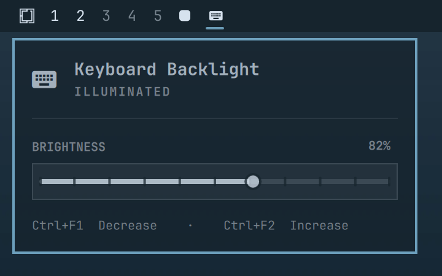

# Omarchy Keyboard Backlight

A native Omarchy bar plugin for controlling a laptop keyboard backlight with an exact percentage slider, quick mouse controls, and optional keyboard shortcuts.

The plugin is event-driven: it reads the hardware when it starts, whenever the popup opens, and after every action. It does **not** poll in the background.



## Features

- Native Omarchy popup with a 0–100% brightness slider
- Automatic `*kbd_backlight*` device detection
- Optional explicit device selection
- Hardware-aware scroll and keyboard steps
- Middle-click off/restore with the last non-zero level remembered
- One-shot IPC actions for synchronized keyboard shortcuts
- No daemon, background timer, network access, or privilege elevation

## Requirements

- Omarchy with the shell plugin system
- `brightnessctl` (included with Omarchy)
- A keyboard backlight exposed under `/sys/class/leds/` with `kbd_backlight` in its name

Check compatibility with:

```bash
brightnessctl --list
```

## Install

```bash
omarchy plugin add https://github.com/funkyspider/omarchy-plugin-keyboard-backlight.git --enable
```

The widget is placed in the right section by default. Move it with:

```bash
omarchy bar move io.github.funkyspider.keyboard-backlight --section right
```

## Remove

```bash
omarchy plugin remove io.github.funkyspider.keyboard-backlight
```

The optional remembered level is stored under
`${XDG_STATE_HOME:-~/.local/state}/omarchy-keyboard-backlight/` and may be
deleted separately if you do not want to retain it.

## Controls

| Input | Action |
|---|---|
| Left click | Open the exact brightness slider |
| Scroll | Increase or decrease brightness |
| Middle click | Turn off or restore the previous level |
| Right click | Turn off |
| Left/Right or `h`/`l` in popup | Adjust by 5% |

The icon deliberately uses the normal bar foreground rather than the active accent colour, keeping it visually consistent with adjacent system controls.

## Optional keyboard shortcuts

MacBook F1/F2 keys are reported to Hyprland as `XF86MonBrightnessDown` and `XF86MonBrightnessUp`. Add these bindings to `~/.config/hypr/bindings.lua` to use `Ctrl+F1/F2` for the keyboard backlight while plain F1/F2 continue to control the display:

```lua
o.bind("CTRL + XF86MonBrightnessDown", "Keyboard brightness down", "omarchy-shell io.github.funkyspider.keyboard-backlight down", { locked = true, repeating = true })
o.bind("CTRL + XF86MonBrightnessUp", "Keyboard brightness up", "omarchy-shell io.github.funkyspider.keyboard-backlight up", { locked = true, repeating = true })
```

Because these shortcuts call the plugin through IPC, the displayed percentage is updated by the action itself—no polling is required.

## Configuration

Automatic detection is appropriate for most laptops. If several keyboard-backlight devices exist, select one explicitly:

```bash
omarchy bar set io.github.funkyspider.keyboard-backlight device 'vendor::kbd_backlight'
```

## IPC

The plugin exposes one-shot commands for scripts and keybindings:

```bash
omarchy-shell io.github.funkyspider.keyboard-backlight up
omarchy-shell io.github.funkyspider.keyboard-backlight down
omarchy-shell io.github.funkyspider.keyboard-backlight off
omarchy-shell io.github.funkyspider.keyboard-backlight power
omarchy-shell io.github.funkyspider.keyboard-backlight brightness 70
omarchy-shell io.github.funkyspider.keyboard-backlight refresh
```

## Development

Validate and test locally:

```bash
omarchy plugin validate .
bash -n bin/keyboard-backlight
python3 -m unittest discover -s tests -v
```

## State and privacy

Only the last non-zero brightness used by the toggle action is stored, under:

```text
${XDG_STATE_HOME:-~/.local/state}/omarchy-keyboard-backlight/
```

The state directory and file are restricted to the current user. The plugin contains no telemetry and makes no network requests.

## Acknowledgements

Automatic device detection, hardware-aware steps, and toggle/restore behavior were informed by [majesticio/omarchy-keyboard-backlight-plugin](https://github.com/majesticio/omarchy-keyboard-backlight-plugin). This project retains the popup slider and event-driven interaction model developed for this version.

## License

[MIT](LICENSE)
